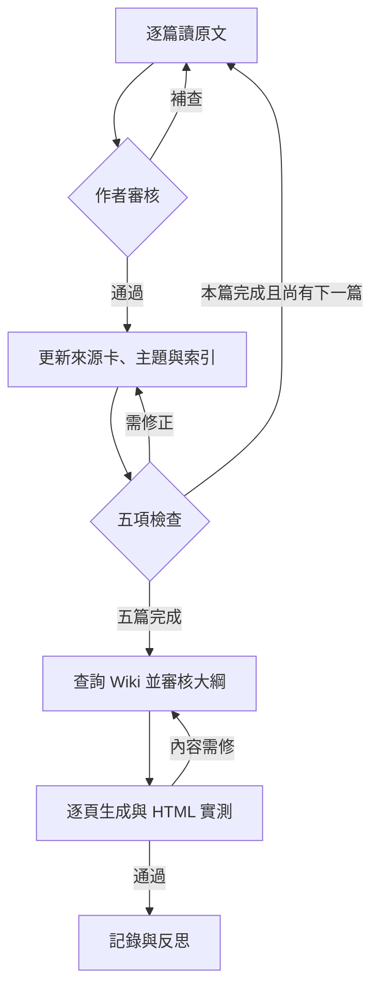

# 製作流程與實測

| 節點 | 通過後 | 需修正時 |
|---|---|---|
| 閱讀原文並送審 | 作者同意後更新來源卡、主題與索引 | 回同篇原文補查 |
| 入庫後五項 lint | 尚有來源則處理下一篇，五篇通過後查詢 Wiki | 修受影響的卡或主題頁，重跑同一個檢查 |
| 教學查詢與大綱 | 作者確認順序後產生逐頁內容 | 依問題回到來源、概念頁或大綱 |
| 網頁實測 | 實測結果與反思寫入紀錄 | 操作問題回 HTML 修正，知識問題回 Wiki |

**本輪實測。** 從 Wiki 首頁進入 W02，核對僅改動操作時的兩列。讀取允許、匯出拒絕，兩列都能追到案例的核准範圍。另從同頁找到 S01 的 AC-6 原則。完整狀態見[工作紀錄](run.md)。互動簡報及公開網址預定在後續階段實測。
